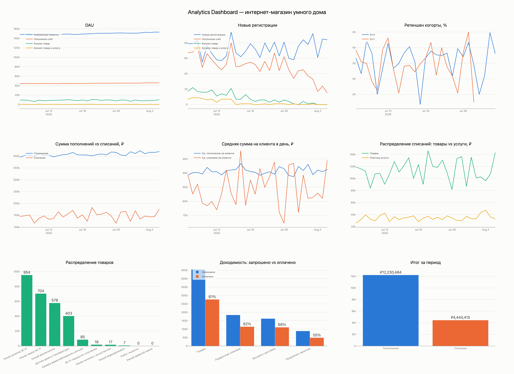

# Исследование и исправление аномалий в дашборде

**Учебный проект по аналитике данных и отладке ETL-процессов.**

**Инструменты:** Python, pandas, SQLite, SQL, Dash, Plotly, Jupyter Notebook.

## О проекте

В аналитическом дашборде онлайн-магазина появились аномалии после изменения обработки пользовательских логов.

Цель проекта — найти причины искажений в показателях и исправить расчёты, не изменяя исходные данные.

## Подход к решению

Сначала изучила графики и выделила подозрительные показатели. Затем сравнила исходные транзакции с данными в аналитических витринах и проверила Python-скрипты, отвечающие за расчёты.

Все исправления проверяла на рабочих копиях файлов и баз данных.

## Найденные проблемы

| Проблема | Исправление |
|---|---|
| Пополнения перестали учитываться после 1 августа | Добавлена поддержка `top-up` наряду с `topup` |
| Retention падал до нуля для незавершённых когорт | Отсутствующие значения заменены на `NaN` |
| При пустом выборе тарифов отображались все данные | Добавлена проверка выбранных подписок |

## Результаты

После пересчёта витрин удалось восстановить **1 250 541 ₽ пополнений**, которые ранее не учитывались за 2–4 августа 2026 года.

Исправлен расчёт Retention D+3, D+7 и D+30 для незавершённых когорт. Также изменено поведение фильтра Pro/Lite при пустом выборе.

Результаты проверены сравнением показателей до и после исправлений.

## Визуализация

Для сравнения использован одинаковый период — 30 дней, с выбранными тарифами Pro и Lite.

### До исправлений

### После исправлений

## Структура проекта

- `analysis.ipynb` — исследование данных, проверка гипотез и сравнение результатов.
- `figures/` — сохранённые графики до и после исправлений.
- `README.md` — описание проекта.

## Вывод

В процессе работы научилась искать причины аномалий, проверять расчёты на уровне исходных данных, анализировать SQLite-базы и тестировать изменения в ETL-процессах.

Проект показал, как небольшое изменение формата данных может повлиять сразу на несколько бизнес-метрик.